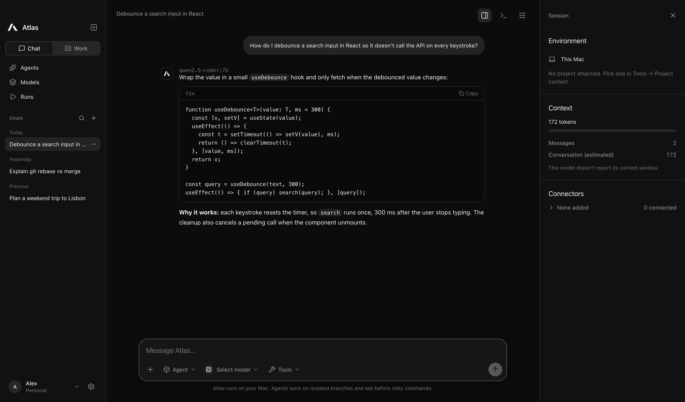
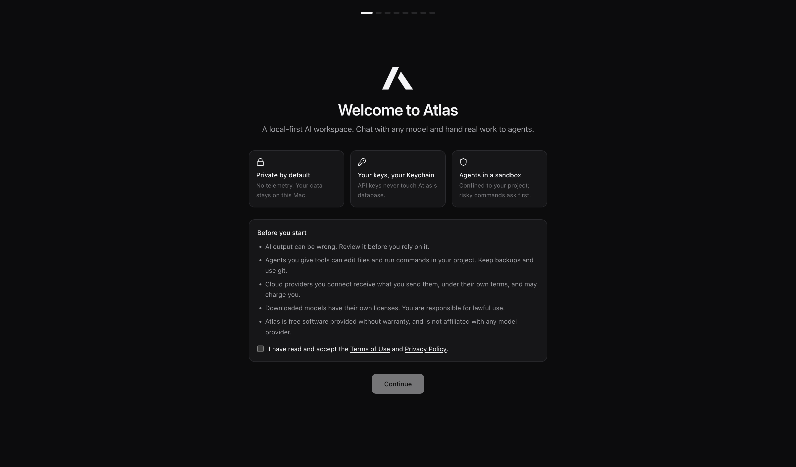
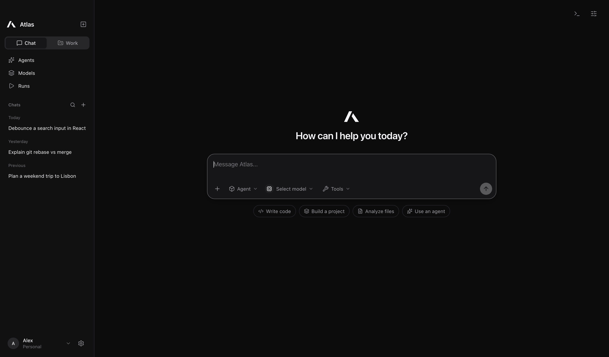
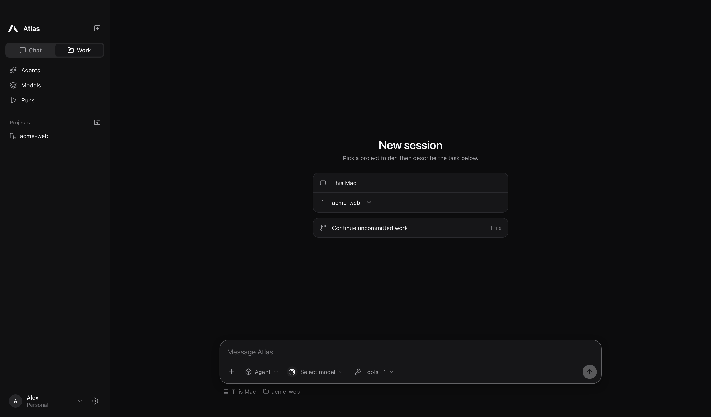
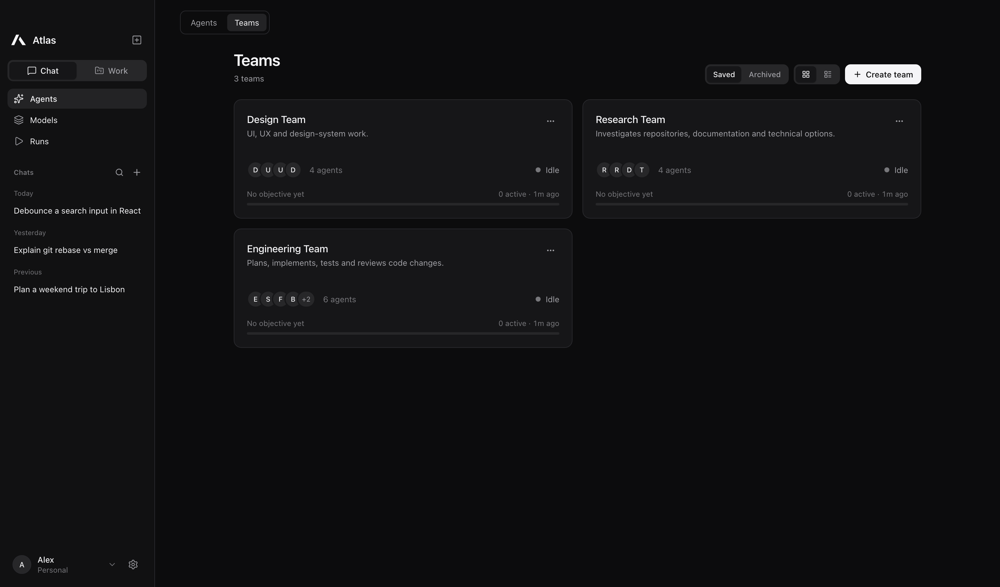
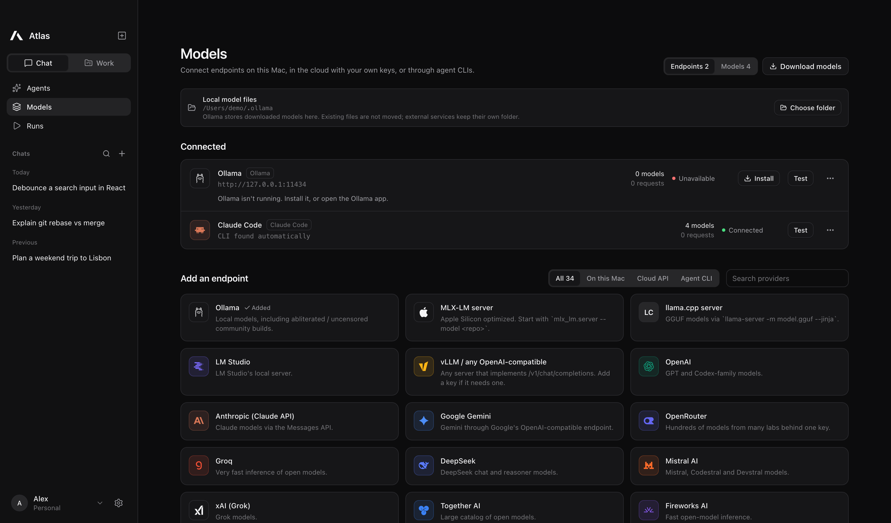
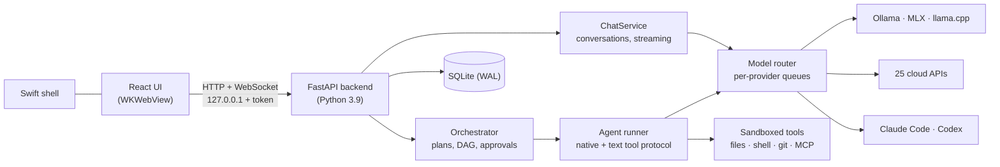

<p align="center">
  <picture>
    <source media="(prefers-color-scheme: dark)" srcset="docs/images/atlas-mark-white.svg">
    
  </picture>
</p>

<h1 align="center">Atlas</h1>

<p align="center">
  <b>A local-first AI workspace for macOS. Chat with any model. Hand real work to teams of agents.</b><br>
  Ollama · MLX · llama.cpp · 25 cloud APIs · Claude Code · Codex · 125 built-in skills: one clean, native app.
</p>

<p align="center">
  <a href="LICENSE"></a>
  
  
  
  <a href="https://github.com/ryuzrx/atlas-harness/releases/latest"></a>
</p>

<p align="center"><a href="https://github.com/ryuzrx/atlas-harness/releases/latest"><b>⬇ Download Atlas for macOS</b></a></p>

<p align="center">
  
</p>

---

Atlas (formerly Atlas Harness) is an open-source desktop app that combines a simple chat interface with a real multi-agent
harness. Ask a question and a model answers, streaming token by token. Give it a task with file or
terminal access and an agent does the work in a sandbox. Hand a whole objective to a team, and the team
lead plans it, delegates subtasks to specialised agents that work in parallel on isolated git branches,
and reports back. You approve risky commands and decide what gets merged.

It runs entirely on your Mac by default. Cloud models are optional, clearly labelled, and use your own
API keys, which are stored in the macOS Keychain.

> **Made for [freeaiapikey.com](https://freeaiapikey.com).** Atlas is the open-source client
> for freeaiapikey.com. Native freeaiapikey.com API and subscription support is planned (see the
> [roadmap](#roadmap)). Until then, any OpenAI-compatible key works through **Models → Add provider → Custom endpoint**.

## Contents

- [Highlights](#highlights)
- [Screenshots](#screenshots)
- [Models and providers](#models-and-providers)
- [Install](#install)
- [Quick start](#quick-start)
- [How a message is answered](#how-a-message-is-answered)
- [Safety model](#safety-model)
- [Architecture](#architecture)
- [Development](#development)
- [Roadmap](#roadmap)
- [Contributing](#contributing)
- [Legal](#legal)
- [License](#license)

## Highlights

- **Chat and Work.** One switch flips the sidebar between chat history and project folders. Work opens a
  "New session" screen: pick a folder, continue uncommitted work, and describe the task. A session panel
  beside each chat shows the environment, context used, connectors and git changes.
- **Skills, built in.** 26 packs with 125 step-by-step skills, covering code review, debugging, git, research,
  writing, design, data, security, DevOps, web, Python, TypeScript, mobile, APIs, prompting, docs, games
  (including Roblox Luau), fiction, support, testing, shell and maths. Type `/` in the composer to use one,
  write your own, or find open-source skills on GitHub.
- **Plugins, hooks and integrations.** Add plugins with an on/off switch. Hooks run your own commands before or
  after a tool (off until you turn them on). Integrations connect in one step from a gallery.
- **Bring your setup.** Import scans for project folders and skills you already use with Claude Code, Codex,
  OpenCode, Cursor and VS Code.
- **Chat first.** The app opens on a conversation. Replies stream in, with Markdown, code blocks and
  copy buttons. History is saved locally, grouped by day, and can be searched, renamed and deleted.
- **One composer, three modes.** The **Agent** menu answers with a model directly, with one of your
  agents, or with a whole team. The **Model** menu lists every model from every connected provider,
  with live status. The **Tools** menu grants project context, file reading or editing, terminal, git,
  memory or MCP for that message.
- **Real multi-agent execution.** Team leads plan objectives into a dependency graph. Independent tasks
  run in parallel, each in its own git worktree. A reviewer verifies the result. Progress shows inline
  in the chat as expandable run panels: agent, task, status, tool calls, output, errors and approvals.
- **Lots of models.** 34 provider presets, including 25 cloud APIs, and a one-click library of 49
  verified Ollama models. **Find the best model for me** reads your Mac's memory, asks two questions and
  recommends one.
- **Works with any model.** Models without native tool calling, such as many abliterated or fine-tuned
  builds, still work as agents through a text tool protocol. ATLAS checks each model's real tool support
  with a test request.
- **Bring your own agent CLIs.** Claude Code and the Codex CLI can run as Atlas agents in isolated
  worktrees, with your own sign-in.
- **Built to be trusted.** Agents are sandboxed to their project, commands follow your policy, nothing
  merges without you, and keys never touch the database or logs.
- **Teams made easy.** Describe what you want to get done and **Help me choose** suggests which preset
  teams you need.
- **Feels like a Mac app.** Native window, Light and pure-black Dark themes, a searchable Settings window, keyboard first (⌘K, ⌘N, ⌘B, ⌘.), subtle
  motion that respects Reduce Motion, and no Electron.

## Screenshots

| First launch | Start a chat |
|---|---|
|  |  |

| Work: pick a project and continue where you left off | Teams of agents |
|---|---|
|  |  |

| Models: local, 25 cloud APIs and agent CLIs, each tested before saving |
|---|
|  |

## Models and providers

**Local (nothing leaves your Mac):** Ollama (ATLAS can install it for you, no admin needed), MLX-LM
server, llama.cpp server, LM Studio, vLLM, or any OpenAI-compatible local server.

**Cloud APIs (your key, stored in the Keychain):** OpenAI · Anthropic · Google Gemini · OpenRouter ·
Groq · DeepSeek · Mistral AI · xAI (Grok) · Together AI · Fireworks AI · Cerebras · SambaNova · DeepInfra ·
Hugging Face Inference · NVIDIA NIM · Novita AI · Hyperbolic · Nebius AI Studio · Inference.net ·
Perplexity · Cohere · Moonshot (Kimi) · Alibaba Qwen (DashScope) · Z.ai (GLM) · MiniMax. You can also
add any **custom OpenAI-compatible endpoint**.

**Agent CLIs:** Claude Code, Codex CLI, and Codex CLI driven by a local Ollama model (`--oss`).

Each cloud preset links to the provider's API key page, and each endpoint URL was checked to exist.
Providers that publish a model list show their full catalog (OpenRouter alone lists hundreds of models).

**Model library.** **Models → Download models** offers 49 Ollama models that were checked against the
Ollama registry. They span Llama, Qwen 3, Qwen 2.5 Coder, Qwen 3 Coder, Gemma 3, gpt-oss, DeepSeek R1,
Mistral, Devstral, Codestral, Phi-4, Granite and more, plus a set of abliterated community builds. You
can also download any other tag, community model (`user/model:tag`) or Hugging Face GGUF
(`hf.co/user/repo:quant`).

> Abliterated models have their safety tuning removed. You are responsible for how you use them.

## Install

Atlas needs **macOS 13+**, the Xcode Command Line Tools (`xcode-select --install`, for Python 3), and
**no admin rights**.

### Download

1. Download `Atlas-<version>-macOS.zip` from the [latest release](https://github.com/ryuzrx/atlas-harness/releases/latest).
2. Unzip it and move **Atlas.app** to `~/Applications` or `/Applications`.
3. The build is ad-hoc signed, not notarized, so the first time you open it, right-click **Atlas.app** and
   choose **Open**. On recent macOS versions, go to **System Settings → Privacy & Security → Open Anyway**.

### Build from source

Requirements:
- Xcode Command Line Tools (`xcode-select --install`), which provide `swiftc` and Python 3.9+.
- Node.js 22 or newer.

```bash
git clone https://github.com/ryuzrx/atlas-harness.git
cd atlas-harness
./scripts/build_macos_app.sh
```

This builds `build/Atlas.app` and installs it to `~/Applications`. Python dependencies are
bundled inside the app, so nothing is installed system-wide. The build is ad-hoc signed, which is fine
for your own Mac. Signed and notarized downloads are on the [roadmap](#roadmap).

## Quick start

1. Open **Atlas**. The welcome guide sets up your theme, a model, safety settings, teams and skills.
2. No model yet? Go to **Models → Download models** and click **Find the best for me**, or click
   **Add provider** and paste an API key.
3. In **Chat**, choose your model in the **Model** menu and send a message. Type `/` to use a skill.
4. To work on code, switch to **Work**, add a project folder (ideally a git repo) or import one from your
   other tools, and describe the task.
5. For bigger jobs, open **Agents → Teams**, click **Help me choose**, then pick the team in the
   **Agent** menu and describe the objective.

| Shortcut | Action |
|---|---|
| `⌘N` | New chat |
| `⌘K` | Command palette: search teams, agents, runs and actions |
| `⌘B` | Collapse or expand the sidebar |
| `↵` / `⇧↵` | Send / new line |
| `⌘.` | Stop the current answer or run |
| `/` | Focus the composer, or pick a skill when typed at the start of a message |

## How a message is answered

| Composer selection | What runs |
|---|---|
| Model, no tools | Streams directly from the provider |
| Model + project context | The project's file list and README are added to the prompt |
| Model + file, terminal or git tools | Runs as the **Atlas Assistant** agent, sandboxed, with approvals |
| An agent | A task for that agent. The selected tools can only *narrow* its permissions |
| A team | An objective: the lead plans and delegates, and the reviewer verifies |

Agent and team replies appear as an expandable run panel. Approval requests appear inside it, and the
final result becomes the reply.

## Safety model

- **Folder confinement.** Agents can only touch the project folder they were given. Paths are resolved
  safely against symlinks, and `.git` internals and credential files (`.env`, keys, certificates) are blocked.
- **Command policy.** Dangerous commands are always denied (`sudo`, disk tools, `launchctl`, Keychain
  access and so on). Destructive commands always ask first. Everything else follows your policy: ask,
  allowlist or auto.
- **macOS sandbox.** Commands run under `sandbox-exec`, so writes outside the workspace fail, and with
  a scrubbed environment that contains no API keys.
- **Isolated branches.** Coding runs happen on `atlas/<task>` branches in separate git worktrees.
  ATLAS never merges by itself, and protected branches need explicit confirmation. Merges refuse to
  overwrite uncommitted work, and rollback is a revert commit.
- **Untrusted repository text.** README files, AGENTS.md and code comments are treated as untrusted input.
- **Keys and network.** API keys live in your login Keychain. The backend listens only on `127.0.0.1`
  and requires a per-launch token.

See [SECURITY.md](SECURITY.md) to report a vulnerability.

## Architecture



- **Frontend:** React 19, Tailwind CSS 4, lucide icons and Vite, in `apps/desktop`.
- **Shell:** a small Swift app (`apps/macos`). It starts the backend, hosts the UI and bridges a few
  native actions: folder picker, notifications, Finder reveal and opening links.
- **Backend:** FastAPI, httpx and SQLite (`backend/atlas`). The chat service, orchestrator, agent runner,
  model router and provider adapters live here.

Details and design decisions: [docs/ARCHITECTURE.md](docs/ARCHITECTURE.md).

## Development

```bash
# backend + tests
python3 -m venv .venv && .venv/bin/pip install -r backend/requirements.txt pytest
.venv/bin/python -m pytest tests

# UI
cd apps/desktop && npm ci && npm run build && cd ../..

# run the backend serving the built UI, then open http://127.0.0.1:8765/#token=dev
cd backend && ATLAS_DATA_DIR=/tmp/atlas-dev ATLAS_TOKEN=dev ../.venv/bin/python -m atlas.main --port 8765 --static ../apps/desktop/dist
```

For live UI development, run `npm run dev` in `apps/desktop` (it proxies `/api` to port 8765) and open
`http://localhost:5173/#token=dev`.

```
apps/desktop    React UI (views, components, design tokens in src/styles.css)
apps/macos      Swift shell, Info.plist, icon renderer
backend/atlas   API, chat, orchestrator, agents, tools, security, providers/, extensions, skillpacks/
tests           pytest suite (scripted test provider + real local HTTP servers)
scripts         app builder and the live acceptance test runner
docs            architecture, dependencies, verification report, release notes
```

Live acceptance tests against a real model:
`ATLAS_TOKEN=dev .venv/bin/python scripts/acceptance.py --provider-kind ollama --model qwen2.5-coder:7b`.

## Roadmap

- [ ] **Native freeaiapikey.com support:** API access and subscription sign-in.
- [ ] Signed and notarized releases with automatic updates.
- [ ] Image and PDF attachments for vision models.
- [ ] Windows and Linux shells (the backend and UI are already portable).
- [ ] Semantic code search and a vector memory.
- [ ] Shareable team templates and skill packs.
- [ ] Import hooks, plugins and chat history from other tools.

## Contributing

Contributions are welcome. Read [CONTRIBUTING.md](CONTRIBUTING.md) first. In short: open an issue for
big changes, keep pull requests focused, run the tests, and never weaken the safety model. Don't add
mock functionality.

## Legal

- [Terms of Use and Disclaimer](TERMS.md) explains what Atlas does and doesn't promise, and what you are responsible for.
- [Privacy Policy](PRIVACY.md): Atlas collects nothing, and your data stays on your Mac unless you send it to a provider you connected.
- [Trademarks](TRADEMARKS.md): Atlas is independent. Provider marks identify compatible services, remain their owners' property, and do not imply affiliation.

Atlas shows a short version of these on first launch and asks you to acknowledge it. You use cloud
providers under their own terms, and downloaded models under their own licenses.

## License

Atlas is free software, licensed under the **GNU Affero General Public License v3.0 or later**
([LICENSE](LICENSE)).

In plain terms:
- You may use, study, modify and share it, including commercially.
- If you distribute a modified version, or run a modified version as a network service that others use,
  you must make your complete source code available under the same license.
- It comes with no warranty.

Third-party components keep their own permissive licenses. See [docs/DEPENDENCIES.md](docs/DEPENDENCIES.md).

Copyright © 2026 the Atlas contributors.
