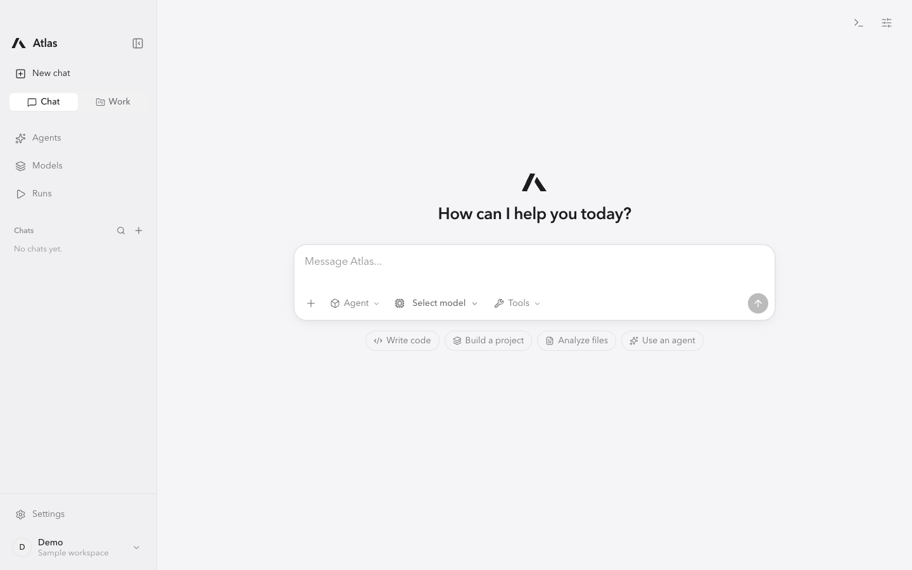
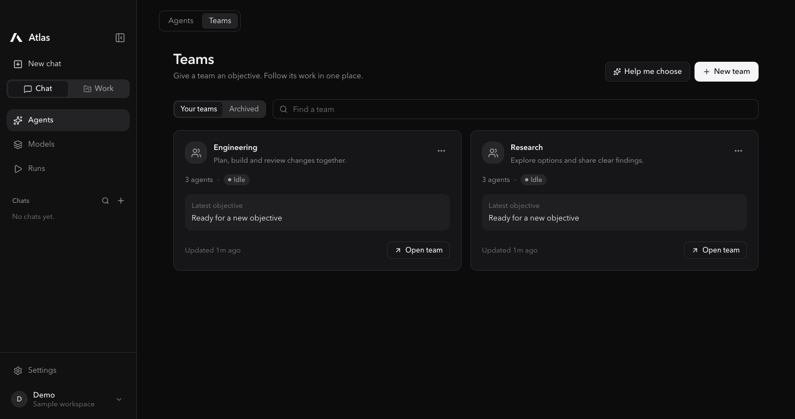
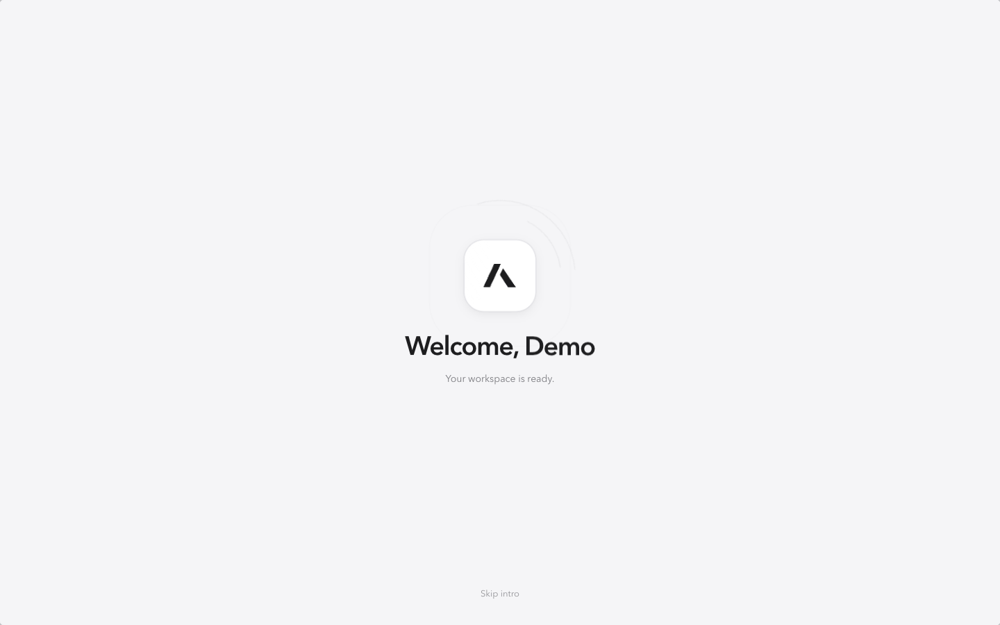

<p align="center">
  <picture>
    <source media="(prefers-color-scheme: dark)" srcset="docs/images/atlas-mark-white.svg">
    
  </picture>
</p>

<h1 align="center">Atlas</h1>
<p align="center"><strong>Your models. Your workspace.</strong><br>Chat, build, and work with teams of AI agents in a macOS app.</p>

<p align="center">
  <a href="https://github.com/ryuzrx/atlas-harness/releases"></a>
  <a href="https://github.com/ryuzrx/atlas-harness/releases/latest"></a>
  <a href="LICENSE"></a>
  <a href="https://github.com/ryuzrx/atlas-harness/actions/workflows/ci.yml"></a>
</p>

<p align="center"><a href="https://github.com/ryuzrx/atlas-harness/releases/latest">Download for macOS</a> &nbsp; · &nbsp; <a href="#build-from-source">Build from source</a> &nbsp; · &nbsp; <a href="docs/ARCHITECTURE.md">Architecture</a></p>


<p align="center"><sub>Light-theme screenshots use fictional teams and a demo profile.</sub></p>

## Explore Atlas

[Chat & Work](#chat--work) · [Models & providers](#models--providers) · [Teams & agents](#teams--agents) · [Personalization](#personalization) · [Install](#install) · [User guide](docs/USER_GUIDE.md) · [Troubleshooting](docs/TROUBLESHOOTING.md) · [Screenshot gallery](docs/SCREENSHOTS.md)

## One workspace, from a question to a project

| Chat | Models | Teams | Work |
| --- | --- | --- | --- |
| Stream replies, attach files, and choose the tools a conversation can use. | Connect endpoints, browse local models, and manage downloads in one place. | Start from a template, choose models by role, and follow each agent's work. | Give agents a project folder, review their changes, and approve actions that need permission. |

- **Local models and optional cloud connections.** Use Ollama, MLX, llama.cpp, LM Studio, compatible servers, or cloud providers with your own credentials.
- **Free-model setup.** First-launch setup offers nine providers with free tiers, evaluation access, monthly credits, or trials. Connect your own key, check the provider's current limits, and pick a model for your first chat.
- **Claude Code and Codex.** Use their existing sign-in. The chat picker shows readable model names and descriptions; Codex can load its local model catalog. Exact model IDs are supported too.
- **Simple team management.** Search teams and agents, assign missing models, pause or resume an agent, and keep tasks, activity, and results together.
- **Make it yours.** Choose a name, profile photo, workspace label, greeting, theme, and launch-animation preference during setup.
- **A compact interface.** Collapse the sidebar into an icon rail. Launch animations open the workspace automatically and can be disabled in Appearance settings. Reduce Motion is respected.
- **Skills and integrations.** Use built-in skills from the composer, add your own, or connect optional MCP integrations. Hooks run only when enabled.



## Chat & Work

Atlas opens into a familiar conversation interface. Select a model, write a message, and follow its reply as it streams. Replies support Markdown, code blocks, and copying. Your conversation history stays in the sidebar, where you can search, rename, or delete chats.

Use the composer to attach text files, paste images for a compatible model, choose an agent or team, and decide which tools are available. A direct model reply, an agent task, and a team objective use the same conversation surface; delegated work appears as an expandable run panel with activity, approvals, and results.

Switch to **Work** when a task needs a project folder. Add a folder, choose a project, and inspect context and Git changes in the session panel. In Git projects, writing tasks can use isolated worktrees so you can review changes before merging them.

| Composer choice | What happens |
| --- | --- |
| Model without tools | A direct streamed reply from that provider |
| Model with project context | The project listing and README are included as context |
| Model with file or terminal tools | An Atlas Assistant task with the selected permissions |
| Agent | A task for that agent; chat tool choices can narrow its permissions |
| Team | An objective that the lead plans and delegates |

### Access, questions, and Atlas Computer Use

Choose **Read only** to inspect project files without edits or commands, or **Workspace** to use the selected project tools under Atlas's existing file and command safeguards. Atlas-managed agents and teams can pause with a question card when they need context; answering resumes the same run.

**Atlas Computer Use** is an optional per-chat mode for eligible models. After macOS Screen Recording and Accessibility permission is granted, Atlas can capture the active display and control visible Mac apps. Clicks, typing, and key presses pause for your approval. It can also run project-scoped build commands, open a `localhost` preview in the default browser, and inspect the result. Screen frames sent to custom or hosted endpoints require an in-chat confirmation, including custom endpoints on `localhost`; captures are not saved by default. Team and CLI modes are not supported for Computer Use in this release. Stopping a run prevents later actions; an action already sent to macOS may finish.

## Models & providers

The Models workspace brings **Runtime sources**, the **Model library**, and **Available models** together. Add a connection, check its health, browse its models, or download a local model without leaving the page.

| Connection | Supported setup |
| --- | --- |
| Local servers | Ollama, MLX-LM, llama.cpp, LM Studio, vLLM, and compatible servers |
| Cloud APIs | Presets for OpenAI, Anthropic, Gemini, OpenRouter, Groq, DeepSeek, Mistral, xAI, and more |
| Custom endpoints | An OpenAI-compatible base URL, with or without an API key |
| Claude Code | Existing CLI sign-in, default model, named aliases, and custom model IDs |
| Codex | Existing CLI sign-in, local model catalog, custom IDs, and an optional local-model configuration |

Additional cloud presets include Together AI, Fireworks AI, Cerebras, SambaNova, DeepInfra, Hugging Face, NVIDIA NIM, Novita AI, Hyperbolic, Nebius, Inference.net, Perplexity, Cohere, Moonshot, Qwen, Z.ai, and MiniMax. Model availability, account access, and supported features depend on each service.

The local library has categories for general use, reasoning, coding, vision and embeddings, and community builds. You can also enter an Ollama tag or supported Hugging Face GGUF reference. The bottom download tray keeps progress visible while you browse other screens, with stop and retry controls.

The chat model picker groups models by provider, shows descriptions and context information when available, highlights your selection, and supports searching by model or provider name. Claude Code and Codex retain their own authentication and model-access rules.

## Teams & agents

Start with an Engineering, Research, Design, Quality Assurance, or DevOps template, or build an empty team. **Help me choose** suggests templates from your description and falls back to keyword matching when a model cannot answer.

Template teams select models by role from available non-CLI endpoints. You can customize planning, engineering, and research routing during setup. **Assign missing models** fills gaps in an existing team while preserving assignments you chose yourself.

A team workspace has five focused views:

- **Work:** describe the objective, follow the current plan, and review task history.
- **Agents:** see roles, assigned models, and status; add agents or open their configuration.
- **Activity:** inspect execution events and tool activity.
- **Resources:** manage shared memory and browse results and artifacts.
- **Settings:** choose the lead and project, rename the team, duplicate it, archive it, or delete it.

The Agents page provides search, team and status filters, pause/resume controls, and a shared creation flow. Detailed controls include instructions, permissions, generation settings, and execution limits. Automatic model selection is optional; individual model assignments remain editable.

## Personalization




Set your display name, profile picture, and workspace label during the welcome guide or from the profile menu. Choose Light or Dark, interface size, chat width, message-send shortcut, and expanded or icon-only navigation.

The launch sequence can greet you by name and opens the workspace automatically when it finishes. You can choose an Atlas-only greeting, disable the launch animation, or reduce motion in **Settings → Appearance**. No entry button is required on normal launches.

## Skills & integrations

Type `/` in the composer to find a built-in skill for the task. Skill packs cover development, debugging, writing, research, design, data, security, planning, and other workflows. You can create your own or add a skill from a folder.

Optional plugins and MCP integrations extend the available tools. Hooks can run commands before or after tool use and stay off until enabled. The Import page can discover supported project folders and skills from other development tools; it is not a complete migration of every application's history or settings.

## Get started

1. Open **Atlas** and complete the initial setup.
2. Open **Models** to connect an endpoint or browse the local model library.
3. Choose a model in the chat composer and send a message. Images require a model that supports them.
4. Switch to **Work** to add a project folder and start a task.
5. For delegated work, open **Agents → Teams**, create a team, and give it an objective.

Template teams choose models from available endpoints. Existing assignments are preserved when you use **Assign missing models**. If a model is unavailable, connect an endpoint and assign it before starting work.

| Shortcut | Action |
| --- | --- |
| `⌘N` | New chat |
| `⌘K` | Command palette |
| `⌘B` | Collapse or expand the sidebar |
| `⌘,` | Settings |
| `↵` / `⇧↵` | Send / new line |
| `⌘.` | Stop the current answer or run |

## Install

### Download the app

Download the Apple Silicon macOS archive from [Releases](https://github.com/ryuzrx/atlas-harness/releases/latest), unzip it, and move **Atlas.app** to `~/Applications` or `/Applications`.

Atlas requires **macOS 13 or newer** and Python 3.9 or newer, available with the Xcode Command Line Tools. Current builds are ad-hoc signed and are not notarized. On first launch, macOS may require **Open Anyway** in **System Settings → Privacy & Security**.

See [release notes](docs/RELEASE_NOTES.md) for the changes in each version. Release archives include a SHA-256 checksum file.

### Build from source

Install the Xcode Command Line Tools and Node.js 22 or newer, then run:

```bash
git clone https://github.com/ryuzrx/atlas-harness.git
cd atlas-harness
./scripts/build_macos_app.sh
```

The builder creates `build/Atlas.app` and installs it to `~/Applications`. Python dependencies are bundled inside the app. Set `ATLAS_INSTALL_DIR` to choose a different installation folder.

## Privacy and control

Atlas stores conversations, settings, and project state on your Mac. API keys are stored in the macOS Keychain. The local backend listens on `127.0.0.1` and requires a per-launch token.

Local inference can stay on your Mac. When you choose a remote endpoint, cloud provider, or hosted agent CLI, relevant messages, attachments, and tool results may be sent to that service. Model downloads and optional integrations make their own network requests. See the [privacy policy](PRIVACY.md).

Agents have project-scoped file access, tool permissions, command controls, and approval requests. Atlas Computer Use is separately enabled per chat and requires macOS permissions; hosted screenshots require an in-chat confirmation. Code tasks can run in isolated Git worktrees. You review and decide what to merge. These controls have limits; review the [security policy](SECURITY.md) and [terms](TERMS.md) before granting tools access to sensitive projects.

## Documentation

| Read this | For |
| --- | --- |
| [Screenshot gallery](docs/SCREENSHOTS.md) | Welcome, setup, chat, models, teams, agents, profile, and settings |
| [User guide](docs/USER_GUIDE.md) | Setup, chat, local models, teams, tools, and personalization |
| [Troubleshooting](docs/TROUBLESHOOTING.md) | Connection errors, downloads, image support, and CLI discovery |
| [Release notes](docs/RELEASE_NOTES.md) | Versioned product changes |
| [Architecture](docs/ARCHITECTURE.md) | Processes, orchestration, storage, and provider adapters |
| [Verification](docs/VERIFICATION.md) | Checks performed and their limits |
| [Security](SECURITY.md) | Security controls and vulnerability reports |
| [Privacy](PRIVACY.md) | Local storage, credentials, and outbound requests |

## Development

```bash
python3 -m venv .venv
.venv/bin/pip install -r backend/requirements.txt pytest
.venv/bin/python -m pytest tests

cd apps/desktop
npm ci
npm run build
```

| Directory | Purpose |
| --- | --- |
| `apps/desktop` | React interface, components, themes, and motion |
| `apps/macos` | Swift shell and native file, image, and notification bridges |
| `backend/atlas` | Local API, model providers, chat, agents, and orchestration |
| `tests` | Backend and provider regression checks |
| `scripts` | App packaging and acceptance tools |

For implementation details and limits, read [Architecture](docs/ARCHITECTURE.md), [Verification](docs/VERIFICATION.md), and [Dependencies](docs/DEPENDENCIES.md). Contributions follow [CONTRIBUTING.md](CONTRIBUTING.md).

## License

Atlas is licensed under [AGPL-3.0-or-later](LICENSE). Third-party components retain their licenses. Provider names and marks identify compatible services and do not imply affiliation; see [Trademarks](TRADEMARKS.md).

Copyright © 2026 the Atlas contributors.
