# Atlas screenshot gallery

[Overview](../README.md) · [User guide](USER_GUIDE.md)

A tour of Atlas in Light mode. Screenshots use a fictional **Demo** profile and sample teams. No personal conversations, account details, or private project files are shown.

[Welcome animation](#welcome-animation) · [Personalization](#personalization) · [Chat](#chat) · [Model picker](#model-picker) · [Models workspace](#models-workspace) · [Download controls](#download-controls) · [Teams](#teams) · [Team workspace](#team-workspace) · [Agents](#agents) · [Work](#work) · [Compact sidebar](#compact-sidebar) · [Profile menu](#profile-menu) · [Appearance settings](#appearance-settings)

## Welcome animation

The launch animation greets the demo profile and opens the workspace automatically. Launch animation and personalized greetings are optional.

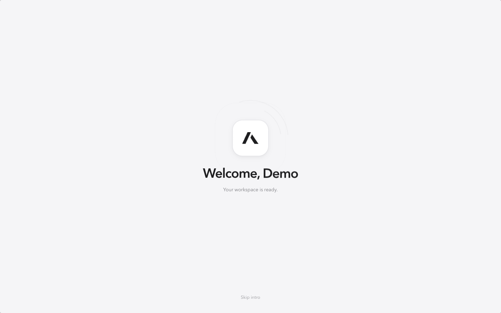

## Personalization

Set a name, photo, workspace label, theme, interface size, chat width, send shortcut, motion, greeting, and sidebar preference.

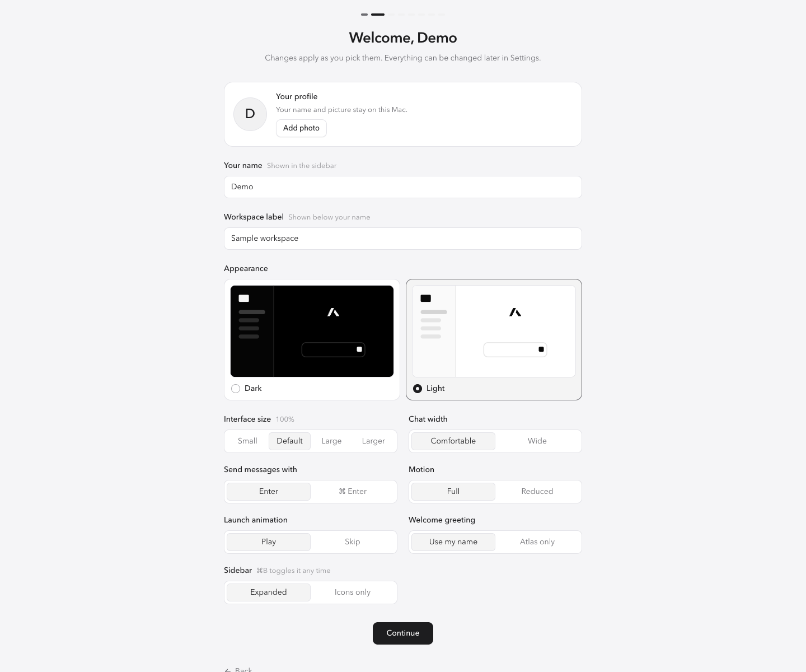

## Chat

Start a conversation, attach files, choose a model, and select agent and tool access.

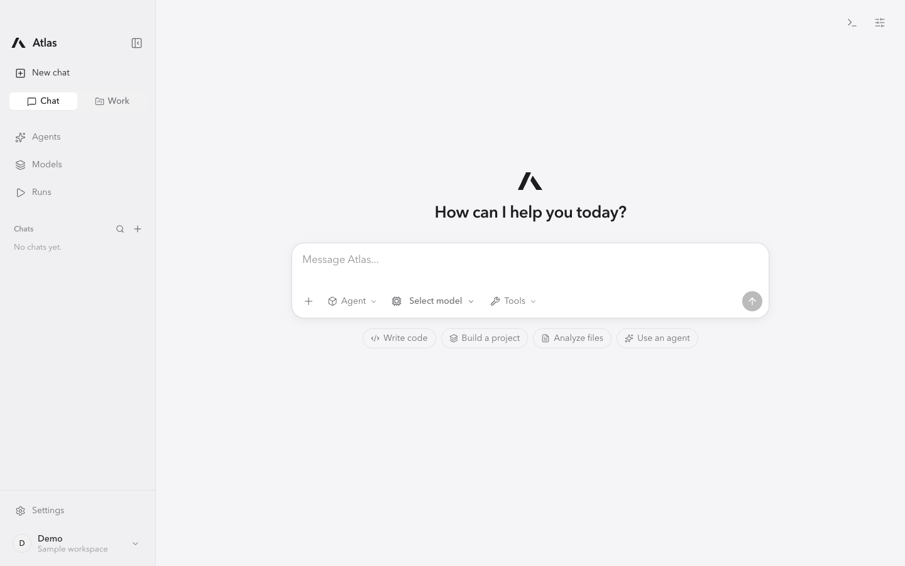

## Model picker

Search models by provider and choose the model for the conversation.

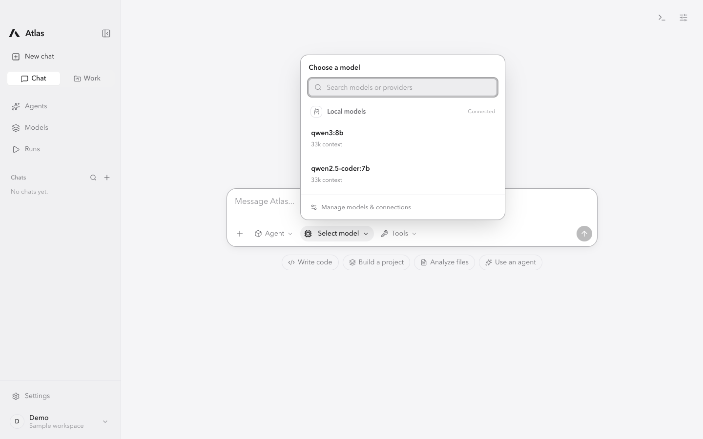

## Models workspace

Manage runtime sources, browse the model library, and inspect available models.

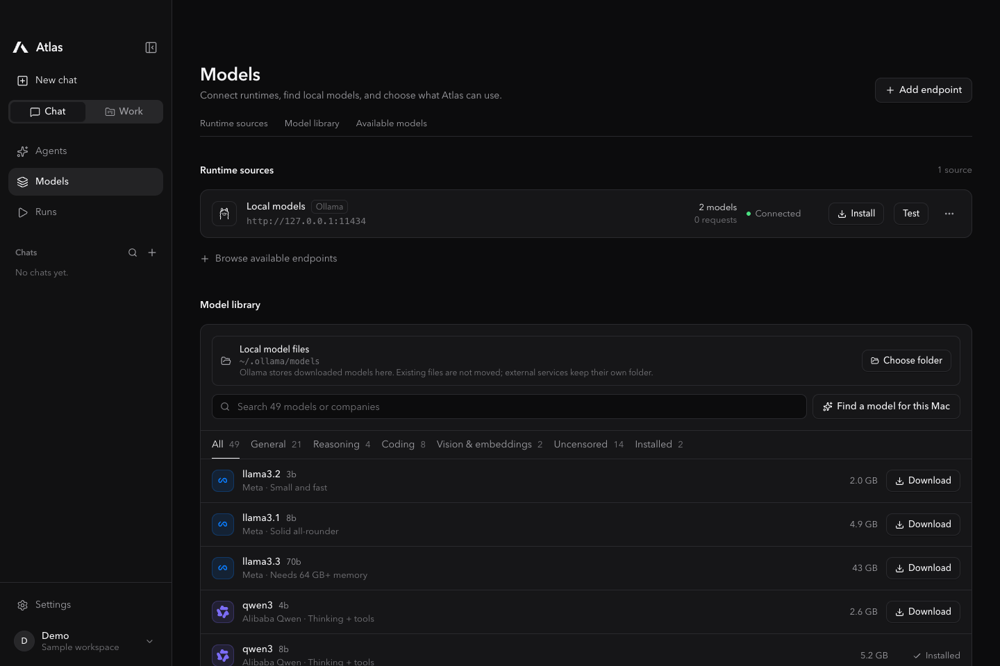

## Download controls

The download tray shows progress and a stop control while the rest of the workspace stays available. This capture uses simulated download progress.

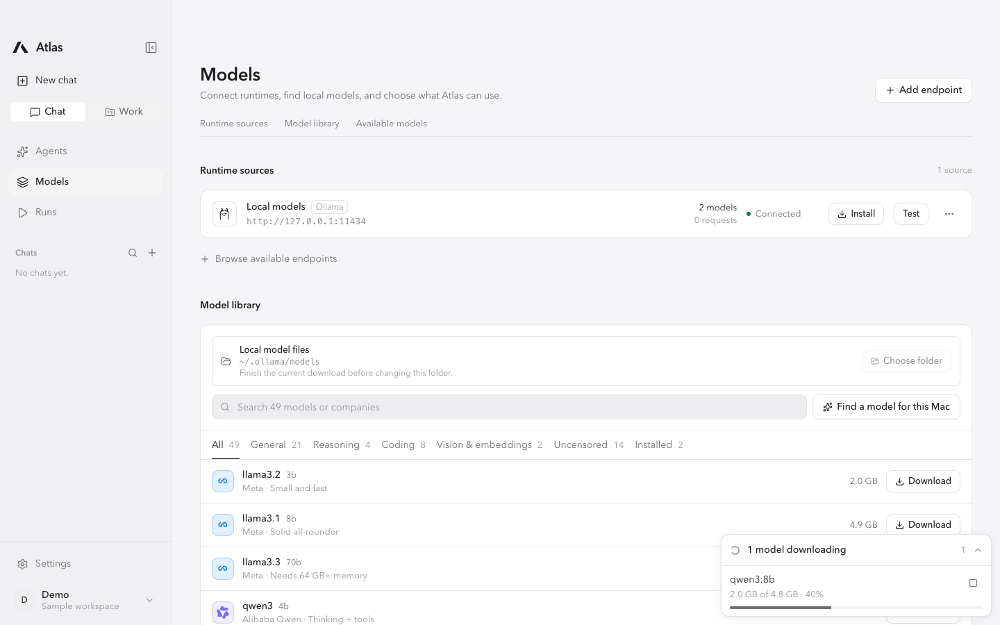

## Teams

Browse demo teams and open their shared workspace.

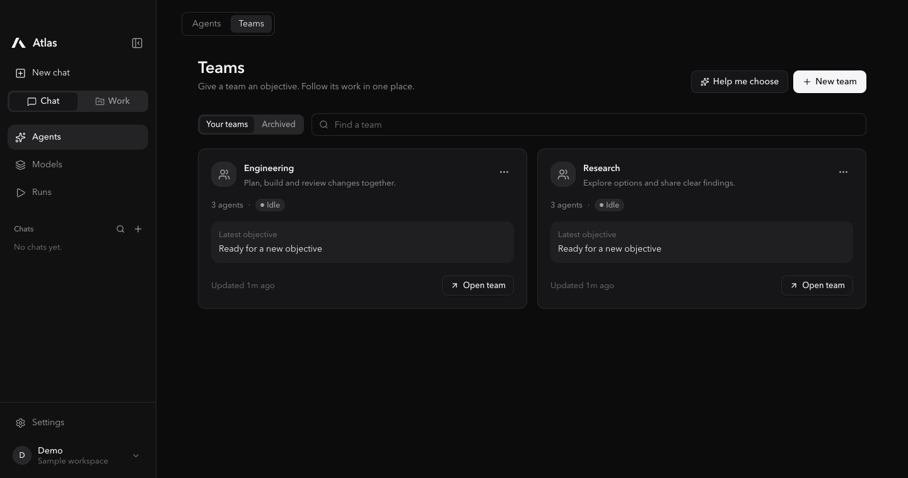

## Team workspace

Give a team an objective and move between Work, Agents, Activity, Resources, and Settings.

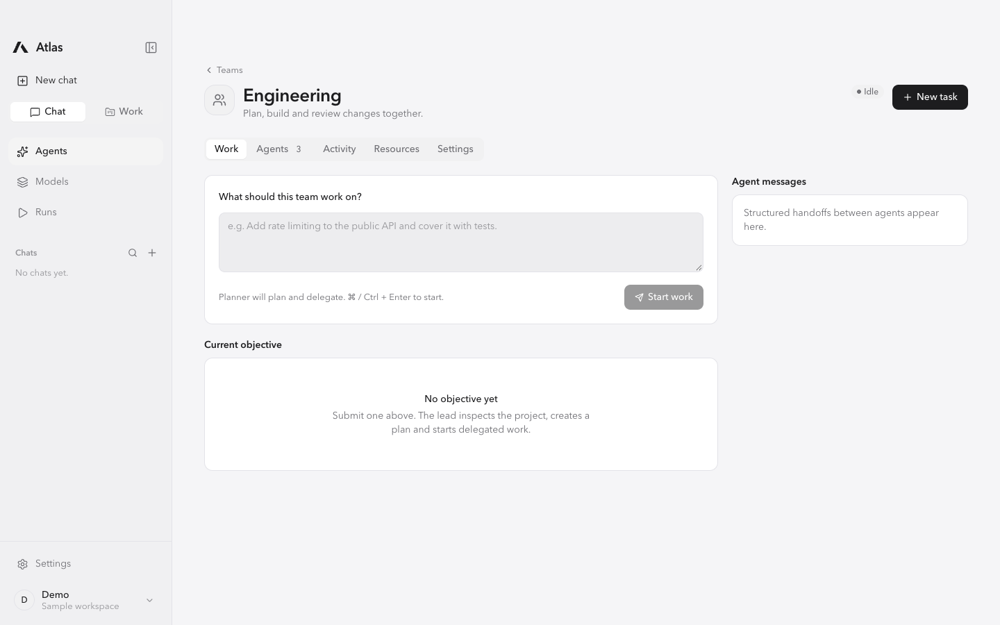

## Agents

Search and filter agents, see their assigned models, and open their management controls.

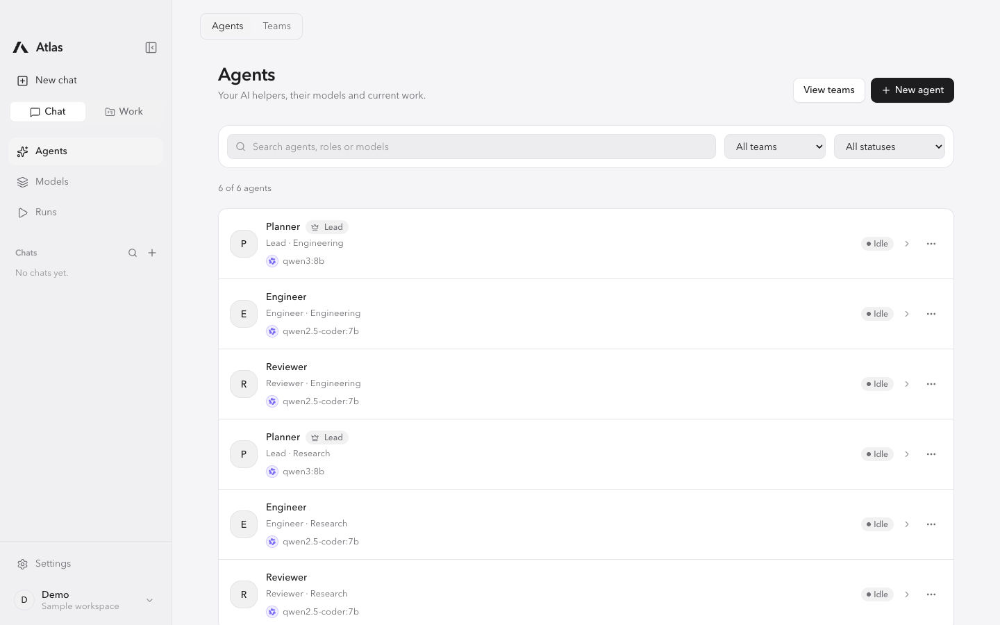

## Work

Choose a project folder and describe a task in a new work session.

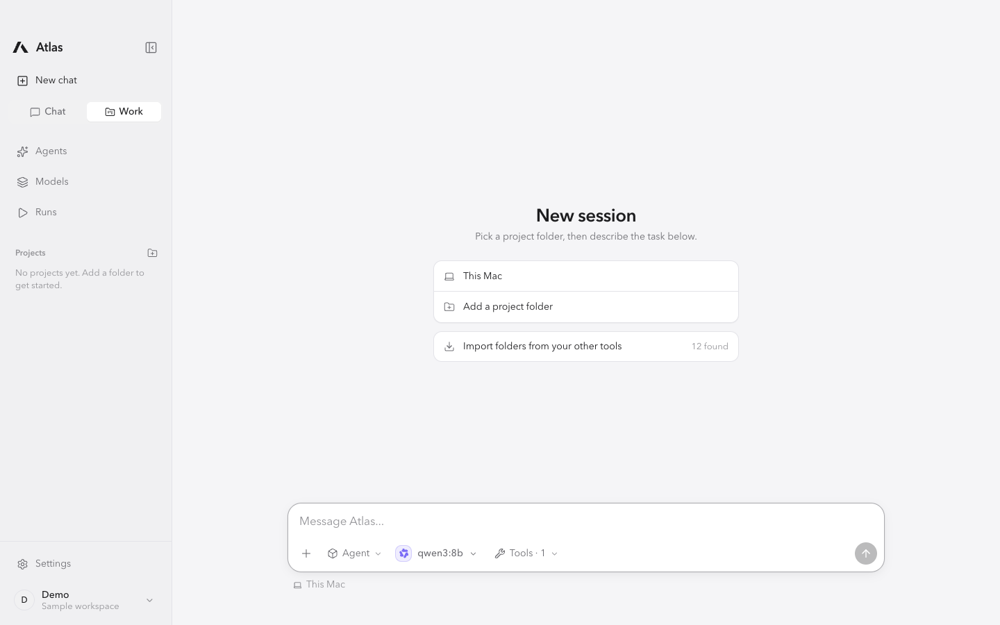

## Compact sidebar

Collapse navigation into an icon rail while keeping the workspace accessible.

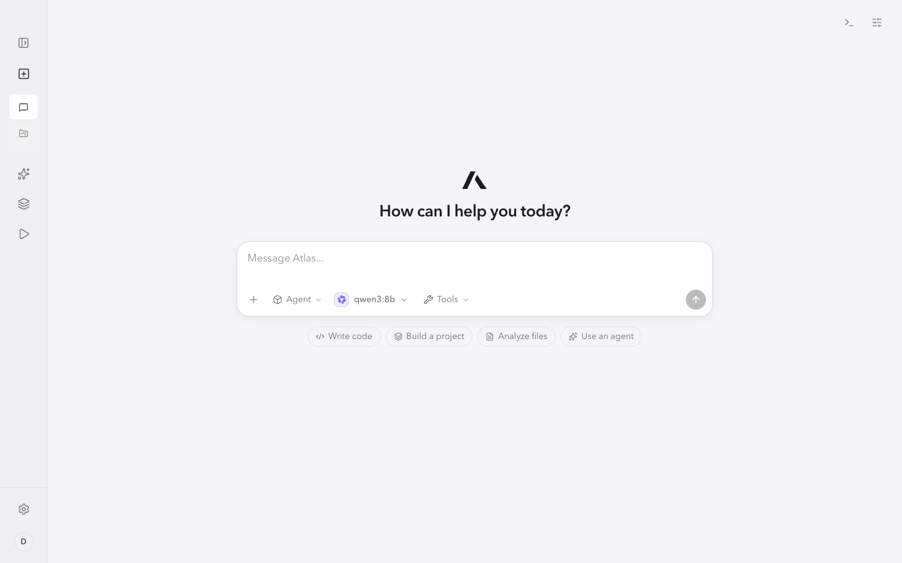

## Profile menu

Open the local profile menu to edit your identity or enter Settings.

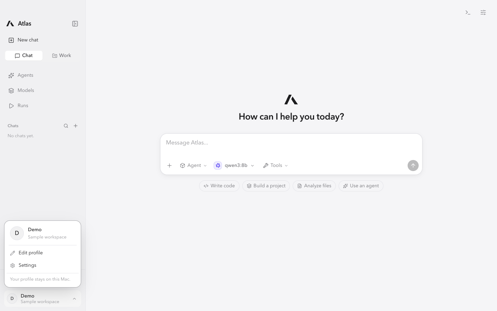

## Appearance settings

Control the theme, interface size, personalized greeting, launch animation, and reduced motion.

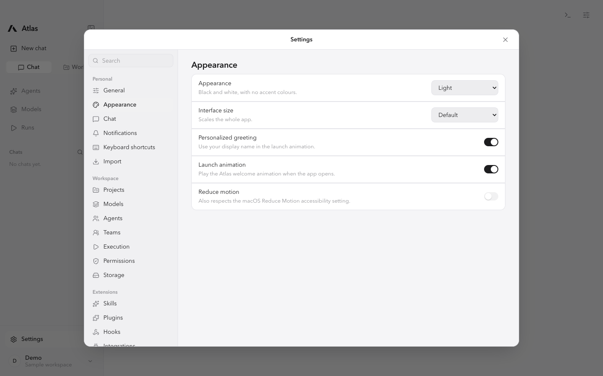
